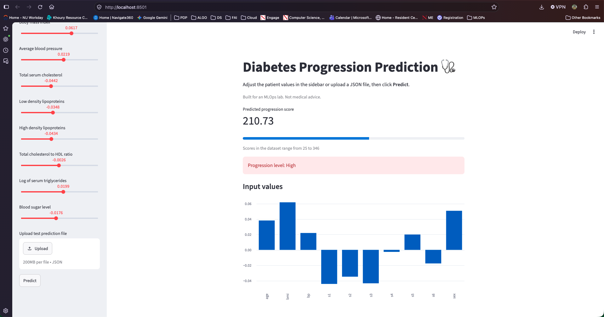
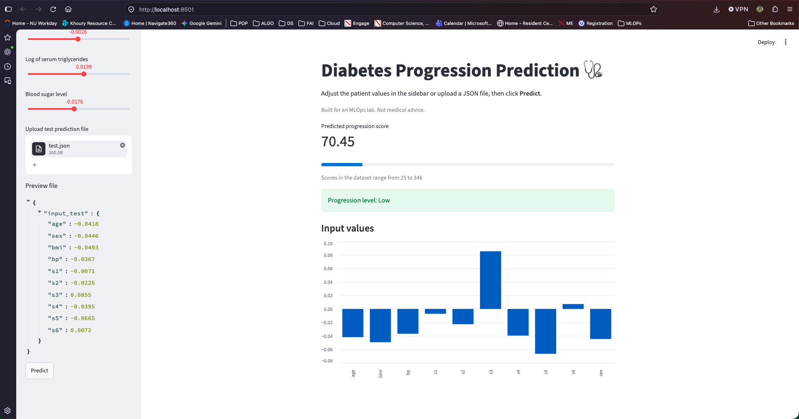

# Streamlit Lab: Diabetes Progression Dashboard

An interactive **Streamlit** dashboard for the Diabetes Progression API built in the [FastAPI lab](../FastAPI_Labs). The dashboard sends patient values to the FastAPI backend and displays the predicted disease progression score.

Based on the [Streamlit Lab](https://github.com/raminmohammadi/MLOps/tree/main/Labs/API_Labs/Streamlit_Labs) from Prof. Ramin Mohammadi's MLOps repo.

## Modifications from Original

| Original Lab | This Lab |
|---|---|
| Iris dataset (flower classification) | Diabetes dataset (progression score regression) |
| Iris FastAPI backend | My Diabetes Progression API from the FastAPI lab |
| 4 sliders | 10 sliders, prefilled with an example patient |
| Text message with the flower name | Score metric, progress bar and color coded progression level |
| No model metrics | Sidebar shows live test R2 and MAE from `/model_info` |
| No input visualization | Bar chart of the input values |
| Iris `test.json` | Diabetes `test.json` with a low progression patient |

## Setup

The FastAPI lab model must be trained first (`FastAPI_Labs/model/diabetes_model.pkl`).

```bash
cd Labs/API_Labs/Streamlit_Labs
python3 -m venv venv
source venv/bin/activate
python -m pip install -r requirements.txt
```

## Run

Terminal 1, start the backend:

```bash
cd Labs/API_Labs/FastAPI_Labs
source venv/bin/activate
cd src
python -m uvicorn main:app --reload
```

Terminal 2, start the dashboard:

```bash
cd Labs/API_Labs/Streamlit_Labs
source venv/bin/activate
cd src
python -m streamlit run Dashboard.py
```

The dashboard opens at http://localhost:8501

## Features

| Feature | Description |
|---|---|
| Backend status | Sidebar shows whether the FastAPI backend is online |
| Model metrics | Live test R2 and MAE from the `/model_info` endpoint |
| Sliders | 10 patient values, prefilled with an example patient |
| JSON upload | Predict from a file such as `data/test.json` |
| Result | Score, progress bar against the dataset range, color coded level |
| Input chart | Bar chart of the values sent to the model |

## Progression Levels

| Score | Level |
|---|---|
| Below 100 | Low |
| 100 to 180 | Moderate |
| Above 180 | High |

## Example Results

| Input | Predicted score | Level |
|---|---|---|
| Default slider values | 210.73 | High |
| `data/test.json` | 70.45 | Low |

## Screenshots





## Project Structure

```
Streamlit_Labs/
├── assets/
│   ├── dashboard.png
│   └── json_prediction.png
├── data/
│   └── test.json
├── src/
│   ├── __init__.py
│   └── Dashboard.py
├── README.md
└── requirements.txt
```
