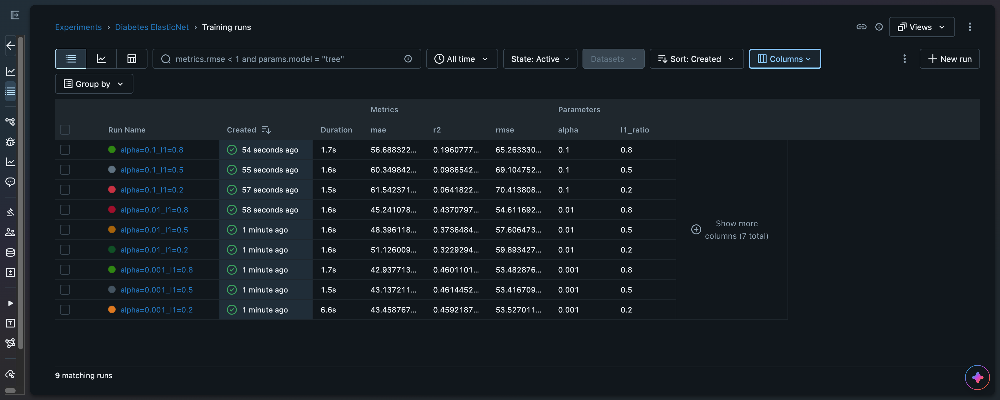
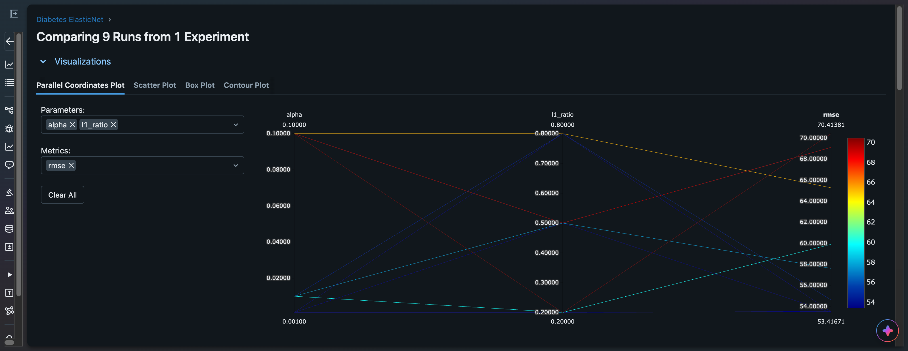

# MLflow Lab 1: Diabetes Experiment Tracking

Tracks a grid of ElasticNet experiments on the scikit-learn diabetes dataset with **MLflow**, then compares every run in the MLflow UI.

Based on [MLflow Lab 1](https://github.com/raminmohammadi/MLOps/tree/main/Labs/Experiment_Tracking_Labs/Mlflow_Labs/Lab1) from Prof. Ramin Mohammadi's MLOps repo. The lab work is in `linear_regression.py`.

## Modifications from Original

| Original Lab | This Lab |
|---|---|
| Wine quality dataset downloaded from the internet | Built in diabetes dataset, no download needed |
| One run per script call, with values typed on the command line | 9 runs in one go: a grid of 3 alpha and 3 l1_ratio values |
| Default experiment with unnamed runs | Named experiment `Diabetes ElasticNet` with a readable name for every run |
| Logs parameters, metrics and the model | Also logs a predicted vs actual plot and a dataset tag for every run |
| Local file store | SQLite tracking store (`mlflow.db`) |
| No summary | Prints every run's scores and the best run at the end |

## Setup

```bash
cd Labs/Experiment_Tracking_Labs/Mlflow_Labs/Lab1
python3 -m venv venv
source venv/bin/activate
python -m pip install -r requirements.txt
```

## Run the Experiments

```bash
python linear_regression.py
```

## Open the MLflow UI

```bash
python -m mlflow ui --backend-store-uri sqlite:///mlflow.db --port 5001
```

Then open http://127.0.0.1:5001

Port 5001 is used because macOS reserves port 5000 for AirPlay.

## Results

| Run | RMSE | MAE | R2 |
|---|---|---|---|
| alpha=0.001, l1=0.2 | 53.53 | 43.46 | 0.4592 |
| **alpha=0.001, l1=0.5** | **53.42** | **43.14** | **0.4614** |
| alpha=0.001, l1=0.8 | 53.48 | 42.94 | 0.4601 |
| alpha=0.01, l1=0.2 | 59.89 | 51.13 | 0.3229 |
| alpha=0.01, l1=0.5 | 57.61 | 48.40 | 0.3736 |
| alpha=0.01, l1=0.8 | 54.61 | 45.24 | 0.4371 |
| alpha=0.1, l1=0.2 | 70.41 | 61.54 | 0.0642 |
| alpha=0.1, l1=0.5 | 69.10 | 60.35 | 0.0987 |
| alpha=0.1, l1=0.8 | 65.26 | 56.69 | 0.1961 |

The best run uses alpha 0.001 and l1_ratio 0.5. Larger alpha values regularize too strongly and the predictions flatten toward the average.

## Screenshots





## Project Structure

```
Lab1/
├── assets/
│   ├── experiment_runs.png
│   └── run_comparison.png
├── .gitignore
├── linear_regression.py
├── README.md
└── requirements.txt
```

The original notebooks and `serving.py` from the course repo are kept for reference.
